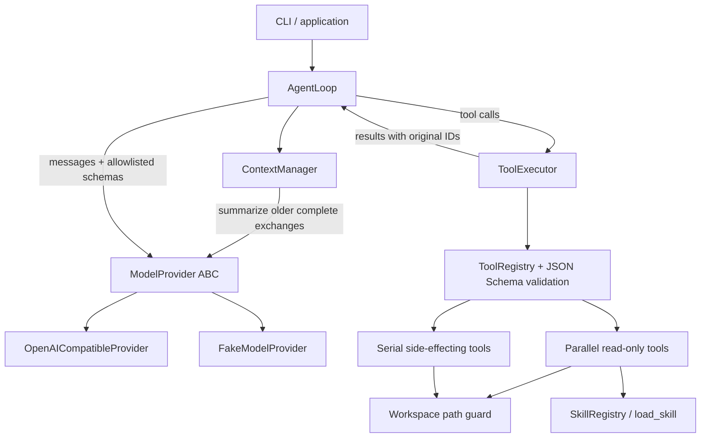

# HKGAI Agent Loop

A lightweight, modular Python 3.11+ agent loop for an interview assignment. It
demonstrates bounded orchestration, context compression, parallel tools, local
skills, and execution safety. No frontend, database, agent framework, or API
credentials are needed for the demo and tests.

## Architecture



| Module | Responsibility |
| --- | --- |
| `agent.py` | Stateful async loop, deadlines, iteration limits, protocol handling |
| `model.py` | Provider ABC, Chat Completions HTTP adapter, scripted fake |
| `context.py` | Approximate token accounting and complete-exchange compaction |
| `tools.py` | Tool ABC, registry, validation, scheduler, example filesystem tools |
| `safety.py` | Workspace confinement, traversal and symlink escape rejection |
| `skills.py` | Local SKILL.md discovery, metadata validation, advisory loader |
| `types.py` | Immutable provider-neutral messages, tool calls, and results |
| `cli.py` | One-shot demo and real-provider command-line interface |
| `demos.py` | Observable compression, timed concurrency, skill/security, and live acceptance demos |

## Installation

From this repository's root on Windows PowerShell:

```powershell
python -m venv .venv
.\.venv\Scripts\Activate.ps1
python -m pip install -e ".[dev]"
```

On macOS/Linux, replace the activation command with `source .venv/bin/activate`.
Activation is optional: commands can use `.venv\Scripts\python.exe` on Windows
or `.venv/bin/python` on macOS/Linux directly.

Runtime dependencies are HTTPX for asynchronous HTTP, jsonschema for argument
validation, and PyYAML for safe metadata loading. Pytest and pytest-asyncio are
development dependencies.

## Run the offline demo

```powershell
python -m hkgai_agent
# Equivalent installed entry point:
hkgai-agent --provider fake --workspace examples/workspace --skills skills
```

Run from the repository root, or supply explicit workspace and skills paths.
The fake provider returns a fixed script: select `workspace-review`, load its
instructions, request two file reads in one response, then return final text.
The CLI prints actual tool outputs, original call IDs, and termination metadata.
It does not pretend to generate an answer to an arbitrary prompt. The real
provider below uses your prompt to generate responses. No network access occurs
in fake mode, even if API environment variables are set.

Expected final metadata: `{"termination": "final", "iterations": 3}`.
The small local reads demonstrate batch scheduling; concurrency tests use
suspending fake tools to prove overlap and enforce the concurrency bound.

## Observable acceptance demos

```powershell
python -m hkgai_agent.demos compression
python -m hkgai_agent.demos parallel
python -m hkgai_agent.demos code-review
python -m hkgai_agent.demos all --output artifacts/acceptance.json
```

`all` runs only offline demos. Each command prints a JSON report with explicit
checks and a `passed` flag; a failed check produces exit code 1. `--output` saves
the same report. Run from the repository root, or pass `--workspace` and `--skills`.

- **Compression:** an artificially small threshold forces a summary. Before/after
  records show every message's role, summary marker, tool-call IDs, and content.
  Long historical content is visibly abbreviated; system/user instructions and
  summary text are short enough to be displayed in full. Checks verify token
  reduction, verbatim system/latest-request retention, budget and read-only task
  state, and complete recent tool exchanges. The summary is scripted, so this
  demonstrates mechanics and preservation checks rather than real-model fidelity.
- **Concurrency:** independent `slow_lookup` and `fast_lookup` tools suspend for
  0.3 and 0.2 seconds. The same calls run with concurrency 1 and 2. Reports show
  actual start/end timestamps, elapsed duration, overlap, values, and call IDs.
  Overlap and ID/value correspondence determine success; speedup is informative
  because wall-clock timing varies by machine. `--delay` changes the fast delay;
  the slow delay is 1.5 times as long.
- **Skill/security:** the agent selects `code_review`, reads the intentionally
  flawed `review_sample.py` as source data, and returns explicitly scripted
  findings. Separate real executor results prove that an outside path, a write,
  and an unavailable shell tool are rejected. The sample file stays unchanged.

The [Chinese acceptance guide](docs/ACCEPTANCE.md) maps these commands to the
five development phases and records the local verification status.

## Environment and real models

| Variable | Meaning | Default |
| --- | --- | --- |
| `OPENAI_API_KEY` | Bearer credential for the configured endpoint | Unset; not needed for fake/local unauthenticated endpoints |
| `OPENAI_BASE_URL` | Chat Completions API root, including `/v1` where needed | `https://api.openai.com/v1` |
| `OPENAI_MODEL` | Tool-capable model identifier supported by your endpoint | Unset; required in real mode |

Set credentials in your environment or secret manager. The program does not
load `.env` files, print keys, or store credentials in conversation history.

```powershell
.\.venv\Scripts\python.exe -m hkgai_agent --provider openai --model gpt-4.1-mini `
  --base-url https://api.openai.com/v1 --workspace examples/workspace --skills skills `
  "Read notes.txt and constraints.txt using read_file, then summarize the goals and constraints from both files. Do not answer before reading both files. Do not modify files."
```

Run this from the repository root with `OPENAI_API_KEY` already set in the same
terminal environment. The CLI reads it directly; no key goes in the command.
To check presence without displaying the value in PowerShell:

```powershell
if ([string]::IsNullOrWhiteSpace($env:OPENAI_API_KEY)) { throw "OPENAI_API_KEY is not set in this terminal." }
```

The explicit model and API root override `OPENAI_MODEL` and `OPENAI_BASE_URL` for
this run. The [official GPT-4.1 Mini documentation](https://developers.openai.com/api/docs/models/gpt-4.1-mini)
lists function calling and Chat Completions support; the model must be available
to your API project. An absent or blank key for `api.openai.com` now produces a
configuration error before making a request. Unauthenticated compatible local
servers remain supported.

Successful end-to-end execution prints successful `read_file` results for both
files, a final answer based on their contents, and `"termination": "final"` with
at least two iterations. The first model turn requests tools; the next model
request contains their observations and original call IDs. A final answer alone
does not demonstrate tool use. Actual iteration counts and call IDs vary by model.
This is a real API request and can incur usage charges; the automated tests use
mock HTTP responses and do not establish live-service success.

For a local compatible server:

```powershell
python -m hkgai_agent --provider openai --base-url http://localhost:8000/v1 `
  --model your-local-model --token-limit-field max_tokens "Inspect notes.txt."
```

The adapter uses non-streaming `/chat/completions`, function tools, and
`max_completion_tokens` by default. Older compatible servers can select
`--token-limit-field max_tokens`. This follows the
[official Chat Completions reference](https://developers.openai.com/api/reference/resources/chat/subresources/completions/methods/create).
Credentials require HTTPS except for loopback hosts. Redirects are disabled.
Provider errors are sanitized; response bodies and credentials are not echoed.
Automated tests stay offline. Complete real-provider acceptance separately:

```powershell
python -m hkgai_agent.demos live --output artifacts/live.json
```

Configure `OPENAI_MODEL` and the credentials required by your endpoint in the
same terminal process first. The live command requires actual successful
`load_skill(code_review)` and `read_file(review_sample.py)` calls followed by a
final model answer; answering without tools fails acceptance. It does not fall
back to a fake model. It can incur API costs and is deliberately excluded from
`all` and CI. Its checks prove orchestration, not the quality of the review.
API configuration and credentials are not written to reports. A saved live
report does contain the reviewed source and model answer, so `artifacts/` is
ignored by Git.

## Limits and tools

```powershell
python -m hkgai_agent --max-iterations 6 --run-timeout 45 --model-timeout 20 `
  --tool-timeout 3 --concurrency 2 --context-tokens 8192 --compact-ratio 0.7
python -m hkgai_agent --help
```

| Setting | Default | Scope |
| --- | --- | --- |
| `--max-iterations` | 8 | Normal model turns per run; summary calls are separate |
| `--run-timeout` | 60 seconds | Entire run, including summaries and tools |
| `--model-timeout` | 30 seconds | Each normal or summarization request |
| `--tool-timeout` | 5 seconds | Each running tool, excluding semaphore wait |
| `--concurrency` | 4 | Concurrent read-only tools per executor |
| `--context-tokens` | 8192 | Approximate total context budget |
| `--compact-ratio` | 0.75 | Compaction trigger as a fraction of context budget |
| `--keep-recent` | 6 | Minimum recent messages, expanded to whole exchanges |
| `--output-tokens` | 1024 | Output reserve and normal model output cap |

Python configuration additionally exposes per-tool timeout overrides, batch size
(16 calls), argument size (16,384 characters), output size (32,768 characters),
summary size (512 requested tokens), and user/response size limits.

- `read_file`: UTF-8 text only, maximum 8192 bytes, workspace-relative path.
- `list_files`: at most 100 entries, no recursive traversal.
- `load_skill`: load a discovered skill by its validated name.
- `write_file`: disabled by default; `--allow-write` explicitly registers and
  allowlists it. Writes at most 8192 bytes atomically to an existing directory.
  Replacing an existing file additionally requires `overwrite: true`.

`AgentResult.termination` distinguishes `final`, `max_iterations`, `timeout`,
`model_error`, `context_error`, `context_limit`, and `invalid_response`.
Tool failures are JSON results (`ok: false`) returned to the model so it can
recover. A final answer can therefore include failed tool attempts; callers
should inspect `tool_results` when they need to require every tool to succeed.
CLI exit codes are 0 for a final answer, 1 for a stopped run, 2 for invalid
configuration, and 130 for a keyboard interruption.

## Reuse and extension

```python
import asyncio
from pathlib import Path
from hkgai_agent import AgentLoop, FakeModelProvider, ModelResponse, ToolExecutor, ToolRegistry
from hkgai_agent.safety import Workspace
from hkgai_agent.tools import ReadFileTool

async def main():
    workspace = Workspace(Path("examples/workspace"))
    executor = ToolExecutor(
        ToolRegistry([ReadFileTool(workspace)]),
        allowed_tools=frozenset({"read_file"}),
    )
    agent = AgentLoop(FakeModelProvider([ModelResponse("Hello.")]), executor)
    result = await agent.run("Hello")
    print(result.response)

asyncio.run(main())
```

Reuse the same `AgentLoop` for subsequent user turns; `history` exposes an
immutable snapshot. Concurrent runs on that instance are serialized. Extend
`ModelProvider.complete` for another backend or `Tool.execute` for a trusted
tool. Tools declare an object JSON Schema with `additionalProperties: false`
and a truthful `read_only` flag. Registration does not imply permission: the
caller must also put the tool name in the executor's explicit allowlist.

Place a skill at `skills/<folder>/SKILL.md`, with YAML front matter containing
only `name` (lowercase letters, digits, hyphens, or underscores, starting with a
letter) and `description` (one line), followed by Markdown
instructions. Discovery is deterministic and restricted to one directory level.
Missing skill directories yield an empty catalog; malformed, duplicate, oversized,
or escaping skills fail discovery. The model sees metadata and chooses whether
to call `load_skill`; instructions are loaded into context only after selection.
No skill text is executed or interpreted as permission configuration.
The bundled skills are `workspace-review` for text summaries and `code_review`
for source-based Python correctness/security reviews.

## Tests

```powershell
python -m pytest -q
```

Tests use fake models and HTTPX's mock transport: no credentials or live endpoints.
They cover lifecycle and multi-turn reuse, tool protocol, iteration/deadline
limits, summary replacement and exchange boundaries, bounded concurrency,
read/write exclusion across batches, partial failures, tool timeouts,
argument validation, skill selection and policy isolation, unsafe paths,
and HTTP request/response/error handling.

## GitHub handoff

The included `.github/workflows/tests.yml` installs the project, runs tests,
and executes both CLI demos on Ubuntu and Windows with Python 3.11 and 3.13.
It requires no API secrets and uses read-only repository permissions. The workflow
uses the official [checkout](https://github.com/actions/checkout/tree/v6) and
[setup-python](https://github.com/actions/setup-python/tree/v6) actions.
The target repository is [zianx2003/hkgai-agent-loop](https://github.com/zianx2003/hkgai-agent-loop).
See [GitHub handoff instructions](docs/GITHUB.md) for local checks and publishing
commands. A successful local test run does not establish that GitHub-hosted CI
has passed; check the repository's Actions tab after pushing.

## Design decisions and tradeoffs

- **Explicit boundaries:** orchestration depends on abstract model/tool interfaces,
  not a provider SDK or filesystem implementation. Dataclasses make state inspectable.
- **Conservative scheduling:** consecutive read-only calls overlap under a semaphore.
  Each write is a barrier: prior reads finish, the write runs alone, then later
  reads proceed. A batch lock prevents interference across concurrent users of
  the same executor. All writes serialize, even to unrelated resources, favoring
  correctness over maximum throughput. Tools marked read-only must be independent;
  dependent actions belong in separate model responses.
- **Transactional compaction:** estimate UTF-8 JSON size at roughly four bytes per
  token plus message overhead, including schemas. At the threshold (or when the
  output reserve needs room), summarize older complete exchanges. Preserve all
  original system instructions, the latest user request verbatim, and recent
  complete exchanges. Prior summaries are included in and replaced by new memory.
  Summary prompts explicitly preserve goals, constraints, decisions, and open work.
  Only adopt a summary if it reduces the estimate. Failed summaries leave history
  unchanged; irreducible input stops with a clear limit status.
- **Cancellation integrity:** deadlines and external cancellation close outstanding
  tool calls with interruption results, preserving a valid conversation for the
  next turn. Cancellation is propagated after history repair. An interrupted
  side effect may already have completed; the result does not claim otherwise.
- **Policy outside the model:** allowlisting and strict JSON Schema validation run
  before execution. Invalid JSON, duplicate keys, nonfinite numbers, unknown
  fields, excessive sizes/depth, absolute/drive paths, traversal, Windows device
  names, and symlink escapes are rejected. No shell, dynamic code execution,
  or permission escalation tool is provided. Skills cannot alter executor policy.
- **Small file operations:** bounded local reads/writes use short synchronous file
  operations inside async tools to avoid orphaned writer threads after cancellation.
  This keeps atomic writes simple; such operations do not provide I/O parallelism.
- **No automatic retries:** callers see model failures immediately. This avoids
  hidden costs or accidentally repeating a side effect. Tests can script failures
  and recovery explicitly.

## Known limitations

- Token accounting is approximate, not a model-specific tokenizer. Configure a
  safety margin. Summary fidelity depends on the model; only system instructions,
  the latest user request, and retained recent messages are preserved verbatim.
- Summarization is one request rather than a chunked pipeline; a provider may reject
  a very large history. It fails cleanly instead of silently truncating task state.
- Async deadlines require cooperative tools/providers. Blocking custom code or code
  that suppresses cancellation cannot be forcibly stopped by asyncio. The example
  file tools assume a normal local disk, not an unresponsive network filesystem.
- Workspace checks are application guards, not an OS sandbox. A hostile local
  process can race symlink changes; read hardlinks are not distinguished from ordinary
  files. Do not use an attacker-controlled workspace or untrusted Python tool code.
  Separate executors/processes do not share locks: share one executor for shared resources.
- Skills and tool outputs may contain prompt injection. The model is warned and
  policy is enforced independently, but semantic manipulation within allowed actions
  cannot be eliminated by this small implementation.
- Text-only, non-streaming Chat Completions is the supported protocol. Model-specific
  roles, reasoning controls, response formats, and server quirks may require an adapter.
- State is in memory; there is no persistence, distributed locking, approval UI,
  telemetry service, or automatic recovery after process exit.
